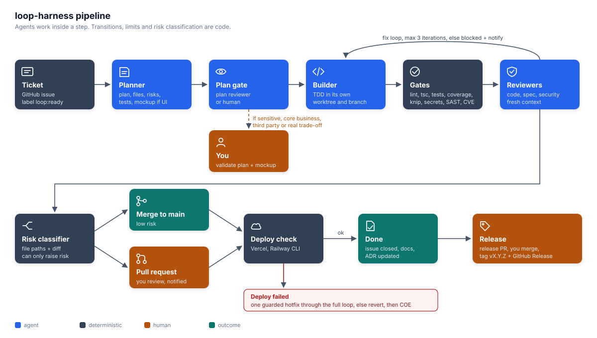

# loop-harness

Guarded autonomous development loop for Claude Code. Install it once, use it on any project and any stack: it takes tickets, plans, builds with TDD, runs deterministic gates, reviews code, spec and security, merges low-risk work and sends sensitive work to you.



## Principles

| Principle | Meaning |
|---|---|
| Deterministic control | Agents decide inside a step. Transitions, limits and risk are code. |
| Risk only goes up | The loop can mark a ticket sensitive, never the opposite. |
| Human on what matters | Sensitive zones, core business, third parties, real trade-offs, releases. |
| No imposed stack | Chosen per project in an ADR; a stack without a rule pack gets one before the loop runs. |
| Rules as source of truth | Every agent reads `rules/`. Every rule names its enforcement: lint, CI, review or PR. |

## Layout

```
.claude-plugin/marketplace.json
plugins/loop-harness/
  .claude-plugin/plugin.json
  rules/
    core.md          language-agnostic rules, decision method, stack selection
    docs.md          documentation conventions
    loop.md          loop behaviour and limits
    languages/       one pack per language: typescript.md
    stacks/          one pack per stack: express.md, mongo.md, angular.md
  templates/         copied into a project by loop-init
    loop.config.yml  becomes .loop/config.yml
    claude/          CLAUDE.md, .claude/settings.json
    github/          issue and pull request templates
    docs/            architecture.md, data-model.md, adr/, coe/
packages/
  eslint-config/     shareable ESLint presets for the [LINT] rules
docs/assets/         diagrams of this repository
```

## Install

```bash
claude plugin marketplace add ProfZidane/loop-harness
claude plugin install loop-harness@loop-harness
```

## Status

Rules and templates are available. Gates, agents and orchestrator are tracked in [issues](https://github.com/ProfZidane/loop-harness/issues), grouped by version label.

## License

MIT
