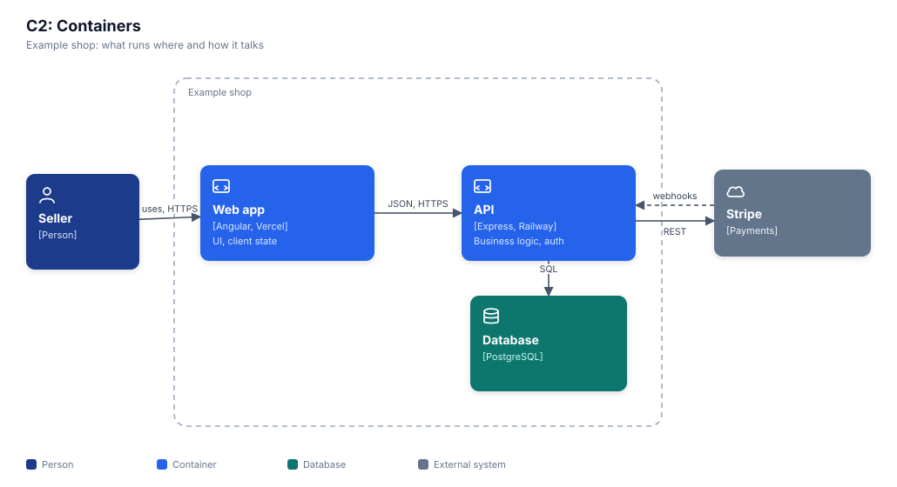

# Architecture

C4 model. One diagram per level, notes underneath back up the key facts.

## C1 · Context

Notes:
- 

## C2 · Containers

Notes:
- Web app and API are deployed separately (Vercel / Railway); auth transport follows `.loop/config.yml` → `security.authTransport`.
- The API is the only container that talks to the database.
- Third-party calls go through one adapter per provider in the API.

## C3 · Components: API

Notes:
- route → validate → controller → service → repository → Mongoose.

## C3 · Components: Web app

Notes:
- 
