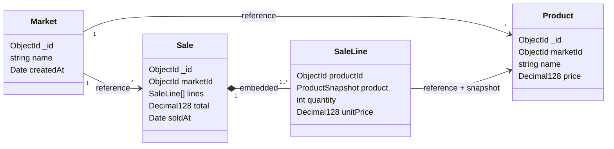

# Data model

## Entities

Notes:
- `SaleLine.product` is a snapshot: price and name frozen at sale time.
- Unbounded histories live in their own collection, never embedded.

## Physical

| Collection | Indexes | Shard key | Retention |
|---|---|---|---|
| sales | `{ marketId: 1, soldAt: -1 }` | none | forever |

## Cross-database links

<!-- other databases, caches, search indexes, and how they stay in sync -->
